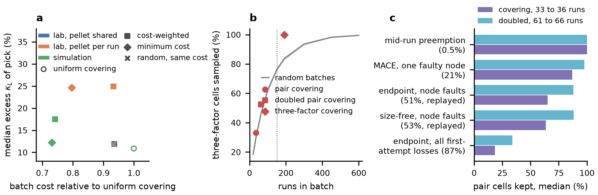

# P3 limitations addressed on this machine: run cost, three-factor coverage, recorded losses

Three limitations stated in the P3 draft
(`../papers/paper3_mol_syst_des_eng/draft.tex`, Strengths and limitations)
are tested here with CPU-light work only (at most 4 threads, no GPU, no CHPC).
Every study reuses the registered P3 SiGeC design study
(`../p3_sigec/run_p3_sigec.py`, imported, hash checks included): the same six
factors (Ge fraction, carbon content, carbon form, effective grain size,
dopant, temperature; 9000 recipes), the same response model, the same
extremely randomised tree surrogate and the same screening score (excess
true kappa_L of the pick among x <= 0.2 at 1100 K). The registered reference
batches are reproduced exactly (`CA1_ref`, 33 runs, seed 16; `CA2_ref`,
62 runs). The tree ensemble runs on 4 threads instead of 8; its seed is
unchanged, so scores are identical.

## Files

| file | role |
|---|---|
| `common.py` | imports the registered study, vectorised greedy covering of strength t and multiplicity m |
| `cost_models.py` | three run-cost models, pellet-aware greedy, LP and ILP (HiGHS) minimum-cost covering |
| `cost_covering.py` -> `results/cost_covering.json` | limitation 1 (17 min on 4 threads) |
| `strength3.py` -> `results/strength3.json` | limitation 2 (2 min) |
| `loss_record.py` -> `results/loss_record.json` | parses the per-run attempt records kept on CHPC |
| `loss_replay.py` -> `results/loss_replay.json` | limitation 3 (1.5 min) |
| `make_figure.py` -> `results/fig_p3_limits.{pdf,png}` | one figure, 17.1 cm wide |

Run with `python3 <script>` (the project Python environment) in this folder,
in the order above. All random draws use fixed seeds.

## 1. Run cost is not uniform

**What the project measured.** Within one simulation method, cost per run
barely depends on the recipe. The 89 MACE-MP-0 runs of the hidden-subset
check (1152 atoms, `../p3_mace/raw/out/*.json`) took a median of 91 min
without carbon and 102 to 104 min with carbon, with no dependence on
temperature or dopant; their full range (63 to 184 min) is set by which GPU
node ran them. The 50 strained-film rNEMD runs (6144 atoms,
`../p3_strain/results/*.log`) took 8.8 to 17.2 min with no factor
dependence. Cost differences across the SiGeC space therefore come from
which method a run needs and from laboratory processing, not from the
recipe inside a method. Three cost models follow from this
(`cost_models.py` docstring gives every number):

- **Laboratory, pellet per run.** Assumed hours, not measured here: milling
  to the target grain size (0.1, 0.3, 0.5, 0.9 um: 20, 10, 5, 2 h), hot
  pressing 3 h, carbon addition (2.5 or 5 nm SiC 4 h, 25 or 100 nm SiC 1 h,
  substitutional carbon by rapid solidification 8 h), dopant 1 h, germanium
  as 4 x_Ge h of material cost, and a laser-flash measurement of 1 h at
  300 K rising to 3 h at 1100 K. One run costs 6.4 to 38 h.
- **Laboratory, pellet shared.** As above, but a pellet is paid once and
  can be measured at several temperatures.
- **Simulation evidence.** Measured per-point costs and the project's own
  validity limits: almaBTE host phonons 75 min per Ge fraction
  (`../party4_bte/RESULTS.md`); at 1100 K, where BTE is not accepted, one
  usable Tersoff rNEMD estimate, 3 box lengths x 23 min
  (`../chpc/RESULTS.md`, `../p3_prework/covering`); for SiC of 5 nm and
  smaller, whose scattering strength is uncertain by a factor of two, a
  MACE check point of 246 min (`../party4_mace/RESULTS.md`).

**Constructors.** The cost-weighted greedy adds the run with the largest
ratio of still-unsampled pair cells to marginal cost (Chvatal's rule) until
every pair of levels is sampled once (single) or twice (doubled, built on
its own single batch); 20 seeds. For the shared-pellet model a variant
whose unit is a pellet measured at a chosen set of temperatures gives the
same cost (within 0.3%). The exact minimum-cost covering is solved as an
integer program (scipy `milp`, HiGHS, 120 s limit) with its proven lower
bound. Random batches are filled with random recipes up to the same cost
(200 per budget).

**Results (medians over 20 constructions; costs relative to the registered uniform-cost covering).**

| cost model | design | runs | cost | excess kappa_L of pick | random batch, same cost: pairs sampled / excess |
|---|---|---|---|---|---|
| lab, pellet per run | uniform covering | 35 | 666 h | 10.9% | 79% / 11.8% |
| | cost-weighted greedy | 41 | 622 h (-6.6%) | 24.9% | 78% / 11.8% |
| | minimum cost (ILP, bound 517 h) | 32 | 531 h (-20%) | 24.7% | 72% / 11.9% |
| lab, pellet shared | uniform covering | 35 | 660 h | 10.9% | 80% / 11.5% |
| | cost-weighted greedy | 69 (37 pellets) | 618 h (-6.4%) | 11.9% | 78% / 11.8% |
| simulation | uniform covering | 35 | 3919 min | 10.9% | 95% / 11.8% |
| | cost-weighted greedy | 75 | 2907 min (-26%) | 17.5% | 92% / 17.5% |
| | minimum cost (ILP, bound 2863 min) | 32 | 2864 min (-27%) | 12.2% | 91% / 17.5% |
| **doubled batches** | | | | | |
| lab, pellet per run | uniform / greedy / ILP (optimal) | 63 / 73 / 60 | 1212 / 1139 / 1034 h | 10.6 / 11.9 / 24.8% | |
| lab, pellet shared | uniform / greedy | 63 / 104 | 1209 / 677 h (-44%) | 10.6 / 14.7% | |
| simulation | uniform / greedy / ILP (optimal) | 63 / 107 / 62 | 6418 / 5322 / 5276 min | 10.6 / 8.5 / 11.0% | |

Findings:

- **The greedy rule recovers most of the saving only when cost differences
  are large.** For simulation evidence the greedy batch is within 1.5% of
  the proven minimum (26% below uniform). For laboratory costs it saves
  6 to 7% where the integer program saves 20% (within 2.6% of its proven
  bound after a two-minute limit); for laboratory budgets the integer
  program is the better constructor.
- **Lowest-cost coverage starves the costly levels, and here the best
  recipe sits on them.** The lowest-kappa_L recipe needs 0.1 um grains and
  2.5 nm SiC, the two most expensive processing levels. Cost-weighted
  laboratory batches sample 0.1 um grains 6 times against 9 for uniform
  covering, and the screening excess rises from 10.9% to about 25%, worse
  than random batches of the same cost (11.8%). Every pair is still
  sampled; the guarantee is kept, but the evidence thins where it is
  expensive.
- **Shared pellets make doubling inexpensive but correlate the losses.**
  Measuring the same 37 pellets at more temperatures doubles every pair
  for 677 h, 44% below the uniform doubled batch. One cracked pellet then
  removes all its measurements: coverage stays complete in 0% of trials,
  against 100% (one pellet lost) and 94% (two lost) for the uniform doubled
  batch, which uses a separate pellet per run.
- Random batches of equal cost never sample every pair (0 of 200 at any
  budget).

## 2. Three-factor coverage

The space has 1982 three-factor level cells; any batch that samples them all
needs at least 6 x 5 x 5 = 150 runs. The same greedy rule, followed by
removal of redundant runs, gives 184 to 197 runs (median 191.5; reference
184, 1.23 times the bound). Random batches need about 1200 runs to sample
every three-factor cell in 90% of draws.

| design | runs | pair cells | three-factor cells | excess of pick (median, IQR) | found best | log RMSE |
|---|---|---|---|---|---|---|
| pair covering | 35 | 100% | 33% | 10.9% (5.5 to 11.8) | 10% | 0.173 |
| doubled pair covering | 63 | 100% | 53% | 10.6% (0.3 to 17.6) | 15% | 0.141 |
| three-factor covering | 191.5 | 100% | 100% | 8.3% (5.5 to 10.8) | 15% | 0.080 |
| random, 191 runs | 191 | 100% | 84% | 7.5% (0.3 to 10.5) | 13% | 0.092 |

The three-factor batch halves the model error but does not change the
screening result: the reference batch picks the best recipe (x = 0.2,
3 at% carbon as 2.5 nm SiC, 0.1 um grains), as the reference doubled pair
batch already did, and at equal size a random batch screens as well. The
factor ranking is unchanged (grain size 46%, carbon form 23%, Ge fraction
16%, carbon content 14%, temperature 1.3%, dopant below 0.1%). In this
response model the interactions that decide the screening are already
reached by pair coverage; three-factor coverage pays for accuracy, not for
the decision.

## 3. Losses that occurred on CHPC guest partitions

**What the record contains.** Three campaigns kept one `attempts` file per
run (start time, SLURM job, requeue counter, host, and a `cuda_init_fail`
note when the GPU was unusable):

| campaign | runs | starts | first attempt completed | node fault at start-up | cancelled by hand, resubmitted | mid-run preemption |
|---|---|---|---|---|---|---|
| P2 endpoint, `gpumd/production_v2` | 63 | 137 | 8 | 32 (notch204) | 23 (notch168, notch294; campaign record seq 31) | 1 |
| size-free HNEMD, `gpumd/sizefree` | 66 | 101 | 31 | 35 (29 notch215, 6 notch458) | 0 | 0 |
| P3 strained films, `p3_strain` | 50 | 50 | 50 | 0 | 0 | 0 |

**What it does not contain.** The 19 MACE runs killed by a GPU memory
fault on notch458 (`../p3_mace/README.md`) are recorded only as a count;
which runs failed is not kept, so only the aggregate rate (19 of 89, 21%)
is used. Phase B rNEMD (29 tasks) and almaBTE (6 tasks) report zero
preemptions in aggregate. The endpoint README states 205 attempts; the
committed per-run files hold 137 starts, and the difference is not in any
committed per-run record. Every node fault ended within about 10 s, before
any production output.

**Replay.** The observed first-attempt outcome sequence of a campaign, in
submission order, is laid over a covering batch in its submission order at
every cyclic offset, which keeps the clustering of faults on one node in
consecutive array tasks. Rates without a per-run sequence are applied as
independent losses (5000 trials). No requeue. Uniform-cost batches, 20
constructions each.

| loss pattern (rate) | single covering: pairs kept / complete | doubled covering: pairs kept / complete |
|---|---|---|
| mid-run preemption (1 in 214 runs, 0.47%) | 100% / 85% | 100% / 99.7% |
| MACE node fault, aggregate (21%) | 87% / 0% | 98% / 1.8% |
| endpoint node faults, replayed (51%) | 65% / 0% | 88% / 0% |
| size-free node faults, replayed (53%) | 64% / 0% | 88% / 0% |
| endpoint, all first-attempt losses, replayed (87%) | 18% / 0% | 34% / 0% |
| strained films, replayed (0%) | 100% / 100% | 100% / 100% |

Submitting in random rather than construction order changes the pairs kept
by at most 7 points. After the endpoint node-fault replay the reference
doubled batch's median screening excess rises from 0% to 11.5%. At the
21% MACE rate a batch needs six-fold pair coverage (180 runs) to stay
complete in 95% of trials; at the pooled 36% first-attempt rate it needs
eight-fold (240 runs).

**Reading.** The losses the project met are of two kinds. Late losses
(preemption during a run) were rare, about one in 200 runs, and the doubled
batch absorbs them: 99.7% of batches stay complete against 85% for a single
batch. Start-up faults on broken GPU nodes were frequent (21 to 53% of
first attempts), clustered on one node at a time, and appeared within
seconds; no affordable redundancy absorbs them, and the remedy the
campaigns used (exclude the node and resubmit, a cost of seconds) is the
right one. A doubled covering batch protects against the first kind; node
screening and resubmission handle the second.

**Figure.** **a**, Batch cost relative to uniform covering against the
median excess kappa_L of the pick, single batches, three cost models.
**b**, Fraction of three-factor cells sampled against batch size; grey line
and band are the median and 10 to 90% range of random batches, dotted line
the 150-run bound. **c**, Median fraction of pair cells kept, without
requeue, under the loss patterns recorded on CHPC.
